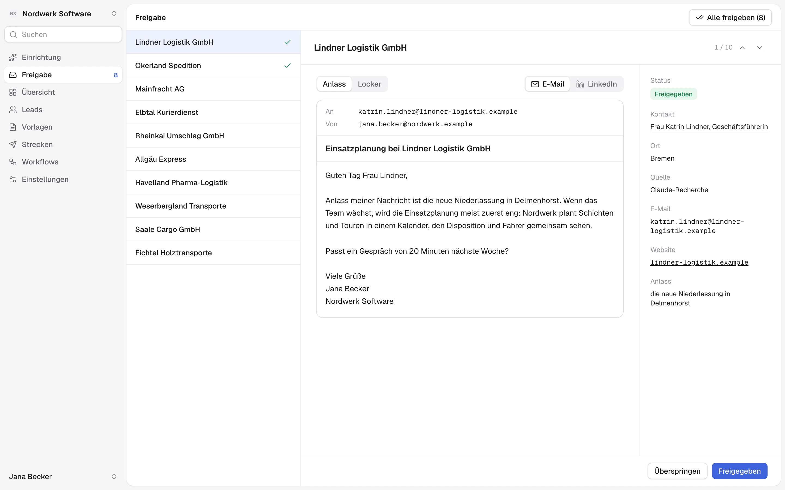
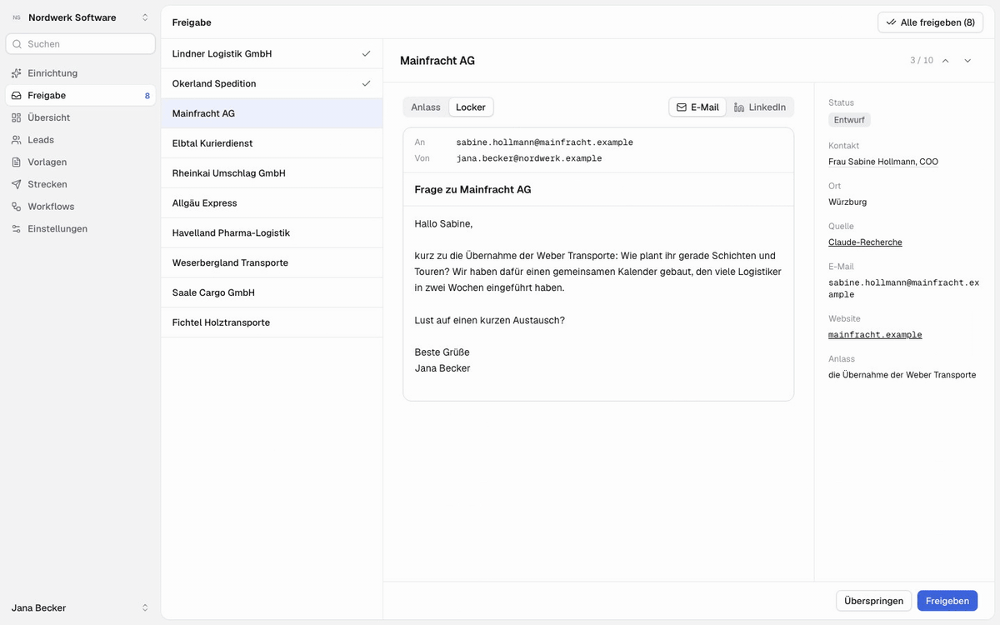
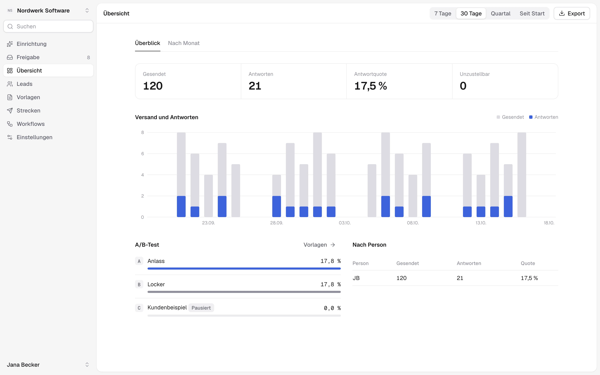
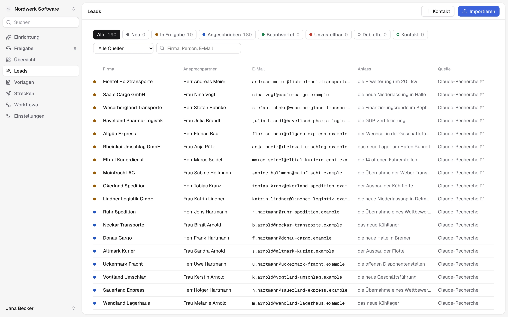
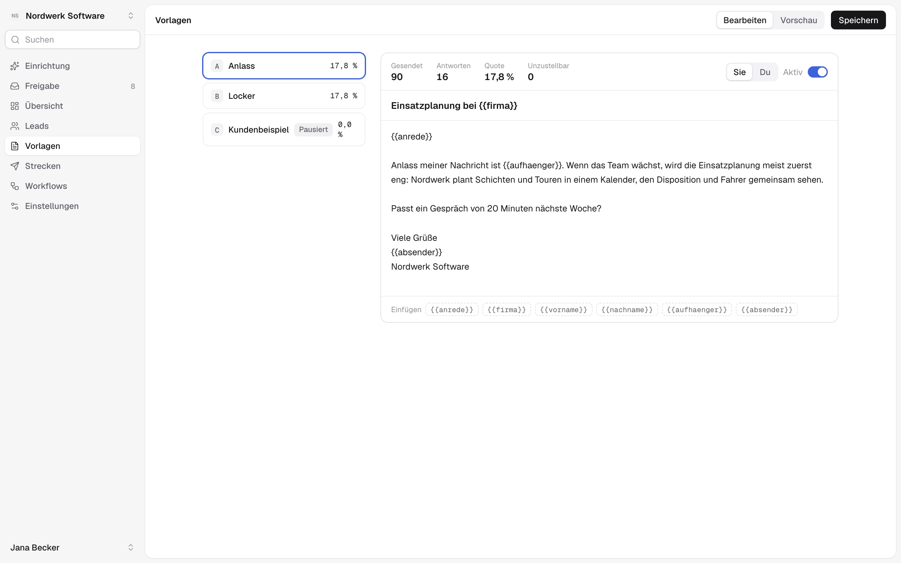
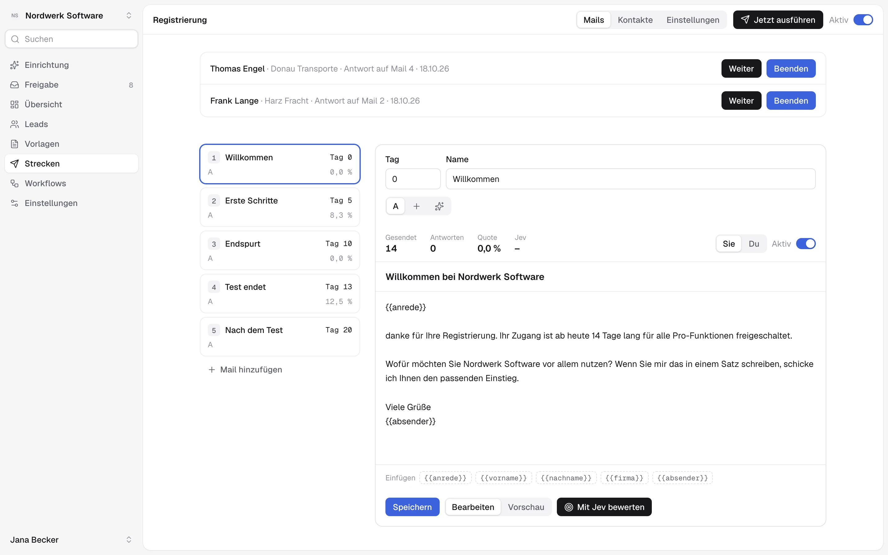
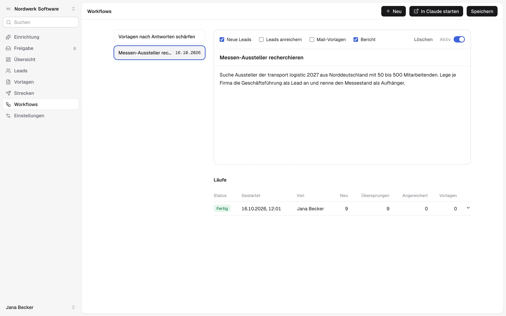

<div align="center">

<picture>
  <source media="(prefers-color-scheme: dark)" srcset="docs/logo-dark.svg">
  
</picture>

# Sales Monster

Kaltakquise per E-Mail für kleine B2B-Teams. Die KI sucht abends Ansprechpartner
mit einem aktuellen Anlass und schreibt Entwürfe. Du liest sie morgens, gibst sie
frei, und um 8 Uhr gehen sie über dein eigenes Postfach raus.

[Ablauf](#ablauf) · [Funktionen](#funktionen) · [Selbst betreiben](#selbst-betreiben) · [Claude-Connector](#claude-connector)

<br>

<picture>
  <source media="(prefers-color-scheme: dark)" srcset="docs/freigabe-dark.webp">
  
</picture>

</div>

<sub>Alle Firmen, Personen und Zahlen auf den Bildern sind erfunden.</sub>

## Ablauf



| Wann | Was passiert |
|---|---|
| Sonntag bis Donnerstag, 20 Uhr | Für jeden Mandanten sucht die KI per Websuche so viele Ansprechpartner, wie in den Einstellungen steht (1 bis 30). Wer schon in HubSpot steht, wird als Dublette markiert und bekommt keinen Entwurf. Für alle anderen entsteht ein Entwurf aus einer der aktiven Vorlagen. Danach bekommen alle Mitglieder des Mandanten eine Erinnerung per Mail. |
| Morgens | Du gehst die Entwürfe in der Freigabe durch, änderst Text oder Vorlage, überspringst oder gibst frei. |
| Montag bis Freitag, 8 Uhr | Freigegebene Mails gehen über Microsoft 365 oder SMTP raus. Ist HubSpot verbunden, wird der Kontakt dort angelegt. Antworten und Unzustellbare der letzten 45 Tage werden erkannt (nur mit Microsoft 365). |

Die Cron-Zeiten in [vercel.json](vercel.json) stehen in UTC. Im Winter laufen
Recherche und Versand deshalb eine Stunde früher, um 19 und 7 Uhr.

## Funktionen

### Freigabe

Jeder Entwurf zeigt Empfänger, Absender, Betreff und Text, daneben Kontakt,
Website, Quelle und den Anlass, den die Recherche gefunden hat. Platzhalter, für
die beim Kontakt keine Daten vorliegen, werden markiert. Freigeben geht einzeln
(Taste <kbd>A</kbd>) oder für alle Entwürfe auf einmal.

### Übersicht



Gesendete Mails, Antworten und Antwortquote nach Zeitraum, Monat und Person. Der
A/B-Test vergleicht die Vorlagen. Alles lässt sich als CSV exportieren.

### Leads



Kontakte, nach Firma gruppiert und nach Status gefiltert. Listen kannst du als
Text einfügen oder als Excel- und CSV-Datei hochladen. Die KI ordnet die Spalten
zu. Pro Firma legst du fest, ob jede Person eine eigene Mail bekommt, alle
zusammen eine oder nur eine Sammeladresse.

Optional liest Sales Monster dein Postfach (Microsoft 365 oder IMAP). Alle, mit
denen du tatsächlich Mails austauschst, werden mit den Daten aus ihrer Signatur
als Kontakt angelegt. Newsletter, Freemail- und Systemabsender werden aussortiert.
Diese Kontakte bekommen keine Kaltakquise-Mails.

### Vorlagen



Betreff und Text mit Platzhaltern wie `{{anrede}}`, `{{firma}}` und
`{{aufhaenger}}`, jeweils in Sie- oder Du-Form. Welche Vorlage ein Entwurf
bekommt, entscheidet Thompson Sampling nach den bisherigen Antwortquoten.

Ein zweites Modell (Jev, über OpenRouter) bewertet Entwürfe nach
Antwortwahrscheinlichkeit, Konkretheit und ob die Bitte am Ende leicht zu
erfüllen ist. Es schreibt selbst keinen Text. Auf Basis dieser Kritik schlägt die
App neue Varianten vor und behält sie nur, wenn Jev sie deutlich besser bewertet.
Ab 30 Sendungen je Variante entscheiden die echten Antwortquoten.

### Strecken



Mailserien für Leute, die sich auf deiner Website registriert haben. Wer in die
Strecke kommt, gekauft hat oder raus soll, bestimmen HubSpot-Eigenschaften. Die
Standardstrecke hat fünf Mails für einen 14-tägigen Test. Antwortet jemand, wartet
die Strecke, bis du auf Weiter oder Beenden klickst. Versendet wird zwischen 8
und 19 Uhr, höchstens eine Mail pro Person in 20 Stunden.

### Workflows



Wiederkehrende Aufgaben, die Claude über den [Connector](#claude-connector)
ausführt, etwa „Suche Aussteller der transport logistic aus Norddeutschland“.
Pro Workflow legst du fest, was Claude schreiben darf: neue Leads, Änderungen an
Leads, Vorlagen oder einen Bericht. „In Claude starten“ öffnet claude.ai mit dem
Workflow. Jeder Lauf erscheint mit Bericht und Zahlen in der Liste.

### Weitere Bereiche

- **Einrichtung:** Ein Chat fragt Website, Zielgruppe, Ansprechpartner und
  Tonfall ab, zeigt Beispiel-Leads zur Bewertung und schreibt daraus den
  Recherche-Prompt und die ersten Vorlagen.
- **Mandanten und Team:** Ein Konto kann mehrere Firmen betreuen. Jede Person
  sieht nur die Mandanten, in denen sie Mitglied ist. Einladungen laufen über
  Links, die einmal gelten und nach 7 Tagen ablaufen.
- **Rechnungen:** E-Rechnungen als ZUGFeRD (PDF/A-3 mit eingebettetem XML) oder
  XRechnung, inklusive Leitweg-ID. Der Bereich erscheint nur bei Mandanten mit
  Rechnungseinstellungen.

## Selbst betreiben

Du brauchst Node.js 20.9 oder neuer und eine Postgres-Datenbank bei
[Neon](https://neon.tech). Gehostet wird auf [Vercel](https://vercel.com).

```bash
git clone https://github.com/niklasafink/salesmonster.git
cd salesmonster
npm install
```

Lege eine `.env.local` an:

```bash
DATABASE_URL=postgres://…          # Neon-Verbindung
APP_SECRET=…                       # langer Zufallswert, z. B. openssl rand -base64 48
CRON_SECRET=…                      # Bearer-Token für die Cron-Routen
APP_URL=http://localhost:3000      # öffentliche Adresse, für Links in Mails
```

Schema anlegen und starten:

```bash
npx drizzle-kit push
npm run dev
```

Unter `/registrieren` legst du das erste Konto an. Beim ersten Mandanten öffnet
sich die Einrichtung.

### Umgebungsvariablen

| Variable | Pflicht | Zweck |
|---|---|---|
| `DATABASE_URL` | ja | Neon-Datenbank |
| `APP_SECRET` | ja | Signiert Sitzungen und OAuth-Tokens und verschlüsselt gespeicherte Zugangsdaten. Wer ihn ändert, macht alle gespeicherten Schlüssel unlesbar und meldet alle ab. |
| `CRON_SECRET` | für Crons | Vercel schickt ihn als `Authorization: Bearer …` an `/api/cron/*` |
| `APP_URL` | empfohlen | Basis für Abmelde- und Freigabelinks in Mails |
| `MS_CLIENT_ID`, `MS_CLIENT_SECRET` | für Microsoft 365 | App-Registrierung in Azure mit Redirect-URI `<APP_URL>/api/integrations/microsoft/callback` und den Berechtigungen `Mail.Send`, `Mail.Read`, `User.Read`, `offline_access` |
| `MCP_REDIRECTS` | nein | Zusätzliche erlaubte OAuth-Redirects, kommagetrennt |

API-Schlüssel für Claude, OpenRouter, HubSpot, SMTP und Resend gehören nicht in
die Umgebung. Du trägst sie in der App unter Einstellungen ein. Sie werden mit
AES-256-GCM verschlüsselt in der Datenbank gespeichert.

### Deployment

Vercel übernimmt die drei Crons aus `vercel.json`. Auf dem Hobby-Plan läuft jeder
Cron höchstens einmal am Tag. Die Strecken brauchen einen stündlichen Lauf, den
die GitHub Action [`.github/workflows/sequences.yml`](.github/workflows/sequences.yml)
übernimmt. Sie braucht das Repository-Secret `CRON_SECRET`, und die URL darin
musst du auf deine eigene Domain ändern.

## Claude-Connector

Sales Monster ist ein MCP-Server unter `/api/mcp`. In claude.ai fügst du ihn
unter Einstellungen → Connectors mit `<APP_URL>/api/mcp` hinzu und meldest dich
mit deinem Sales-Monster-Konto an. Die App ist dabei selbst der
OAuth-Server (Authorization Code mit PKCE, dynamische Client-Registrierung).
Freigegebene Verbindungen kannst du in den Einstellungen widerrufen.

| Tool | Zweck |
|---|---|
| `tenants_list` | Mandanten mit verbundenem CRM, Postfach und KI |
| `leads_list`, `leads_add`, `leads_update` | Leads lesen, anlegen und ergänzen |
| `templates_list`, `templates_save` | Vorlagen lesen und vorschlagen; neue Vorlagen kommen pausiert an |
| `workflows_list`, `workflow_start`, `run_finish` | Workflows ausführen und den Lauf mit Bericht abschließen |
| `mail_sync_status`, `mail_sync_run` | Postfachabgleich prüfen und anstoßen |

## Entwicklung

| | |
|---|---|
| Framework | Next.js 16, React 19 |
| Datenbank | Neon Postgres mit Drizzle ORM, Schema in [`src/db/schema.ts`](src/db/schema.ts) |
| KI | Anthropic SDK (Claude Sonnet 5.5 mit Websuche) oder OpenRouter |
| Mail | Microsoft Graph, nodemailer (SMTP), imapflow (IMAP), Resend für Systemmails |

Die Vitest-Suite in `test/` läuft nur gegen einen Neon-Testbranch und bricht ab,
wenn `TEST_DATABASE_URL` fehlt:

```bash
TEST_DATABASE_URL=postgres://… npm test
```

Die Playwright-Tests in `tests/` laufen gegen `BASE_URL` und melden sich mit
einem QA-Konto an, das `npx tsx scripts/qa-user.ts` anlegt:

```bash
BASE_URL=http://localhost:3000 npx playwright test
```

## Noch nicht fertig

- Antworten und Unzustellbare werden nur mit Microsoft 365 erkannt, nicht bei
  Versand über SMTP.
- Die Integrationen Vergabehero und SendPilot sind angekündigt, aber nicht
  gebaut.
- `bridge/` ist ein Entwurf und noch nicht angebunden.
- Die Produktions-URL steht fest in der GitHub Action, in
  `playwright.config.ts` und im OpenRouter-Referer in `src/lib/ai.ts`.
- Das Rechnungs-PDF zeichnet noch ein festes Logo.

## Lizenz

Für dieses Repository ist noch keine Lizenz festgelegt.
